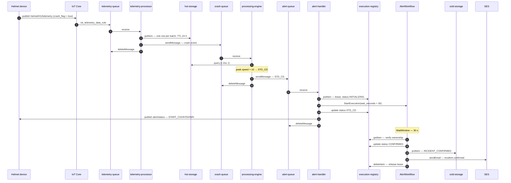
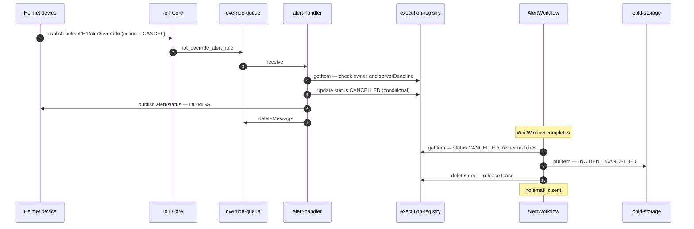

# Data flow

Two directions, and they never share a queue:

- **Inbound telemetry** — device → IoT Core → rules → SQS → services → DynamoDB.
- **Outbound alerting** — services → DynamoDB / Step Functions → SES, plus a
  small control message back to the device.

Everything between the broker and the services is a queue. There are no direct
service-to-service calls except `StartExecution` to Step Functions.

---

## 1. Topics, rules and queues

All four rules are plain `SELECT *` on a topic filter, with the queue as the
target. No Lambda, no republish, no transformation.

| Topic | Rule | Target queue |
|---|---|---|
| `helmet/+/telemetry` | `iot_telemetry_data_rule` | `smart-helmet-telemetry-queue` |
| `helmet/+/alert/override` | `iot_override_alert_rule` | `smart-helmet-override-queue` |
| `helmet/+/lwt` | `iot_lwt_rule` | `smart-helmet-lwt-queue` |
| `helmet/+/control` | `iot_control_rule` | `smart-helmet-control-queue` |

`helmet/+/alert/status` is not a rule source — it is the topic the system
**publishes to**. The device subscribes to it; the simulator's IoT policy
allows `iot:Subscribe` and `iot:Receive` on that topic filter, and no other
subscription.

---

## 2. Queues and their consumers

| Queue | Produced by | Consumed by | On repeated failure |
|---|---|---|---|
| `telemetry-queue` | IoT rule | `telemetry-processor` | DLQ after 3 receives |
| `crash-queue` | `telemetry-processor` | `processing-engine` | DLQ after 3 receives |
| `alert-queue` | `processing-engine` | `alert-handler` | DLQ after 3 receives |
| `override-queue` | IoT rule | `alert-handler` | DLQ after 3 receives |
| `control-queue` | IoT rule | `processing-engine` | DLQ after 3 receives |
| `lwt-queue` | IoT rule | `processing-engine` | DLQ after 3 receives |

All twelve queues (six sources, six DLQs) are **standard**, not FIFO. Each
source sets `maxReceiveCount = 3`, and each DLQ has a redrive-allow policy back
to its source, so a poison message can be inspected and replayed rather than
only discarded.

---

## 3. Storage

| Table | Key | Written by | TTL |
|---|---|---|---|
| `smart-helmet-hot-storage` | `helmetId` + `timestamp` | `telemetry-processor` | 24 h |
| `smart-helmet-cold-storage` | `helmetId` + `timestamp` | Step Functions | none |
| `smart-helmet-execution-registry` | `helmetId` | `alert-handler`, Step Functions | deadline + 24 h |
| `smart-helmet-device-status` | `helmetId` | `processing-engine` | 15 min |

Hot storage is short-lived raw telemetry; cold storage is the durable incident
record. They are separate tables because they have opposite lifetimes: the
telemetry that *justified* an alert should expire, the alert should not.

---

## 4. A crash, end to end

## 5. A cancel inside the window

---

## 6. What the queue choice costs

Standard SQS queues give **at-least-once** delivery and **no ordering
guarantee**. Both properties are visible in the design rather than papered
over:

- **Duplicates** are expected. The lease acquisition, the conditional writes in
  the workflow, and the deterministic `incident_id` (`uuid5` of helmet,
  timestamp, location, speed) all exist so a duplicate is absorbed rather than
  producing a second alert. Step Functions execution names add a second layer:
  a duplicate `StartExecution` for the same incident is rejected by AWS.
- **Out-of-order crashes** are resolved by timestamp, not arrival time. A crash
  older than the lease currently held is dropped as stale.
- **A crash and its LWT can race.** The LWT path reads `device-status` to decide
  whether the disconnect was graceful; if the control message has not been
  processed yet, the LWT is treated as genuine and escalates. That is the safe
  direction of the ambiguity.

---

## 7. What is deliberately not in this path

| Not used | Why |
|---|---|
| S3 for telemetry | The only bucket holds Terraform state. Hot and cold storage are DynamoDB. |
| Kinesis / Firehose | Traffic is per-helmet and low-volume; a stream would add a consumer to manage for no gain. |
| Lambda | The rules write straight to SQS; a function between them would be another failure domain and another deployment. |
| A data warehouse | Telemetry expires after 24 hours by design; there is no analytics tier to feed. |
| An API between services | Every hop is a queue, so a slow consumer applies backpressure instead of failing a request. |
