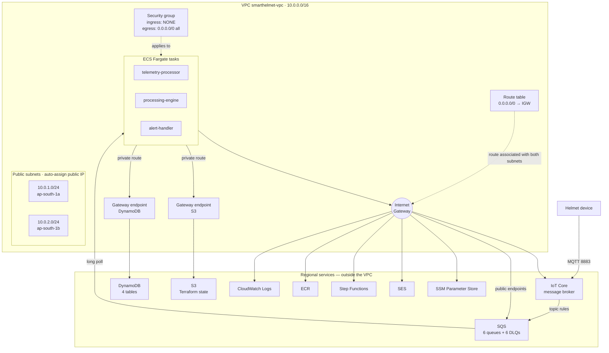

# Network architecture

Everything runs in one VPC in `ap-south-1`. There are **no private subnets, no
NAT gateway and no load balancer** — the tasks are pull-based workers, not
request servers, which changes what the network has to do.

| | |
|---|---|
| VPC | `smarthelmet-vpc` · `10.0.0.0/16` · DNS hostnames + support enabled |
| Subnets | 2 public · `10.0.1.0/24` (`ap-south-1a`) and `10.0.2.0/24` (`ap-south-1b`) |
| Public IP | `map_public_ip_on_launch = true`, tasks use `assign_public_ip = true` |
| Egress to internet | Internet Gateway, via `0.0.0.0/0` in the public route table |
| Gateway endpoints | S3 and DynamoDB |
| Security group | `smart-helmet-ecs-infra-sg` — **no ingress rules**, one egress `0.0.0.0/0` all protocols |
| NACLs | VPC defaults (allow all) |
| VPC flow logs | none |
| Compute | ECS Fargate · cluster `smart-helmet-cluster` · 3 services × 2 tasks |
| Logs | CloudWatch Logs `/ecs/smart-helmet-cluster` |

---

## 1. The layout

Only two things are drawn inside the VPC boundary besides the tasks: the
Internet Gateway and the two **gateway** endpoints. Everything else — SQS,
DynamoDB's control plane, ECR, CloudWatch, Step Functions, SES, IoT Core — is
a regional service reached over the AWS network.

---

## 2. What actually takes which path

| Traffic | Path | Notes |
|---|---|---|
| S3 (state bucket, not used at runtime) | Gateway endpoint | Added to the route table; never leaves the AWS network |
| DynamoDB | Gateway endpoint | Same |
| SQS (6 queues, 6 DLQs) | **Internet Gateway** | Long-poll receive and send |
| IoT Core (`iot-data:Publish` for countdown messages) | **Internet Gateway** | Public data endpoint |
| CloudWatch Logs (`awslogs` driver) | **Internet Gateway** | |
| ECR (image pull at task start) | **Internet Gateway** | |
| Step Functions (`StartExecution`) | **Internet Gateway** | |
| SES (the workflows send mail) | **Internet Gateway** | Called by Step Functions, not by the tasks |
| SSM Parameter Store (countdown windows) | **Internet Gateway** | |

The gateway endpoints are free; the Internet Gateway is free. There is no NAT
gateway, which is the single biggest cost decision here — a NAT gateway is a
fixed hourly charge regardless of traffic.

---

## 3. Why the subnets are public and why that is not the risk it sounds like

A task with a public IP normally means an inbound path exists. Here it does
not, because the security group has **no ingress rules at all** — not a
restricted one, none. Nothing can initiate a connection to a task.

The public IP exists solely so that **egress** works without a NAT gateway.

Three properties make this safe:

1. **No inbound rule.** AWS security groups are deny-by-default; with an empty
   ingress list, any connection attempt is dropped before it reaches the task.
2. **No load balancer and no service discovery.** Nothing routes traffic *to*
   the tasks. They only ever initiate connections outward.
3. **The health endpoint is local.** The container health check runs
   `urllib.request.urlopen("http://localhost:8080/health")` from inside the
   container, so the HTTP server binding `0.0.0.0:8080` is never reachable from
   the network.

This trade-off is recorded as an ADR rather than left implicit — see
[`docs/adr/0001-public-subnets-and-gateway-endpoints.md`](adr/0001-public-subnets-and-gateway-endpoints.md).

---

## 4. What the tasks can reach

The egress rule is `0.0.0.0/0`, all protocols. That is broader than any single
service needs, and it is accepted rather than overlooked: the three services
between them call SQS, DynamoDB, S3, SSM, IoT Core, Step Functions, CloudWatch
Logs, ECR and SES, across nine AWS service prefixes and the public endpoint for
IoT. Pinning that list precisely would produce a rule set that breaks whenever
a service adds a call — which is exactly how a pipeline goes down at an
awkward moment.

The documented finding (`AWS-0104`) records the same thing.

---

## 5. Gaps in this layer

- **No VPC flow logs.** There is no record of accepted or rejected network
  connections. Application logs and IoT Core logs are the only network-adjacent
  evidence, and neither shows a connection that was blocked by a security
  group.
- **No private subnets.** Moving the tasks to private subnets would require a
  NAT gateway (for the non-endpoint services) and would add fixed hourly cost
  without removing anything, because there is no inbound path to remove.
- **The endpoint list is short by design.** Only the two highest-traffic,
  best-supported gateway endpoints are present. Every other service traverses
  the Internet Gateway.
- **No WAF, no ALB, no API Gateway.** There is no HTTP surface to protect.

---

## 6. Where this is defined

| Object | File |
|---|---|
| VPC, subnets, IGW, route table | `infra/platform/vpc.tf` |
| Gateway endpoints | `infra/platform/vpc.tf` |
| Security group and egress rule | `infra/platform/security_groups.tf` |
| Cluster, log group, execution role | `infra/platform/ecs_cluster.tf` |
| Subnet / SG IDs published to SSM | `infra/platform/ssm_outputs.tf` |
| Task networking and health check | `services/<name>/infra/service.tf` |
