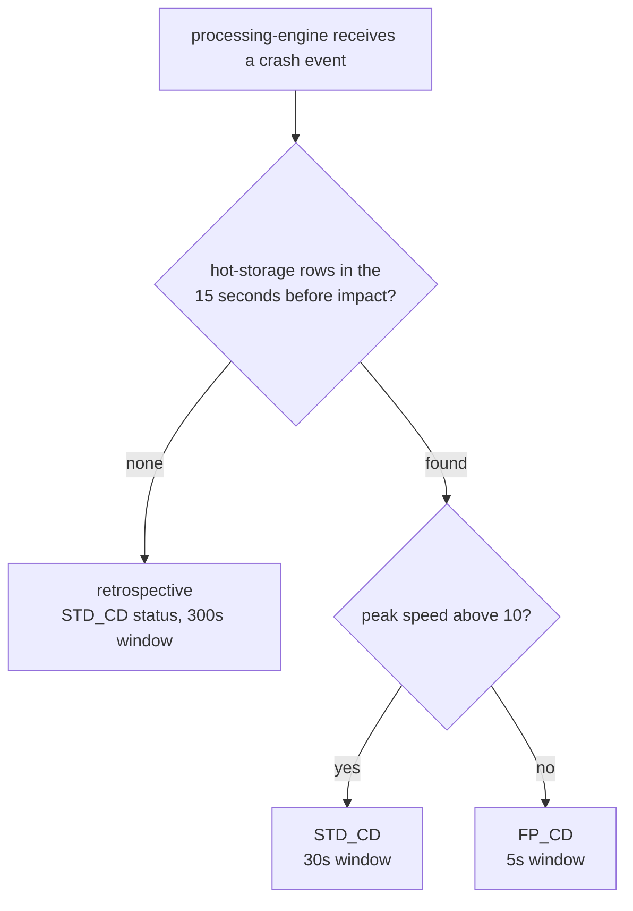
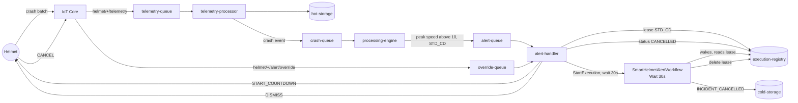
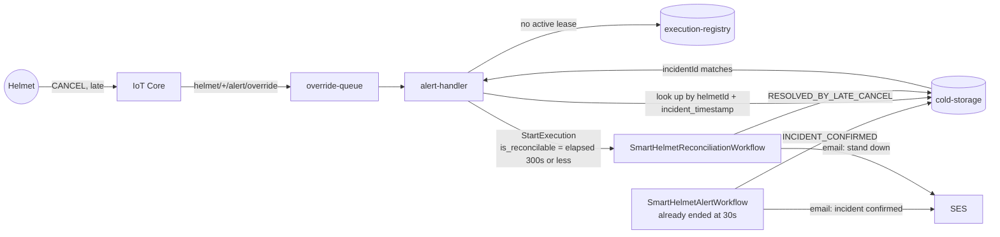
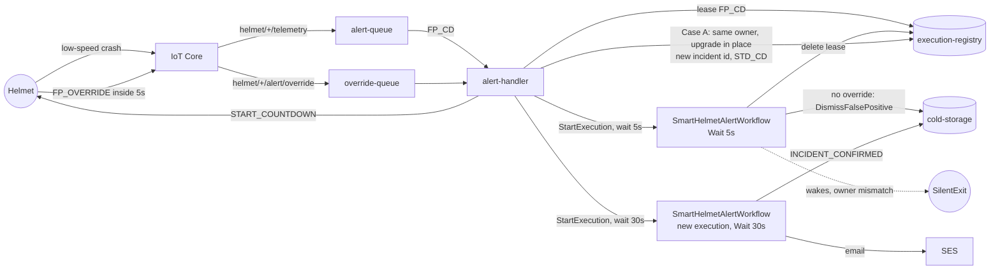
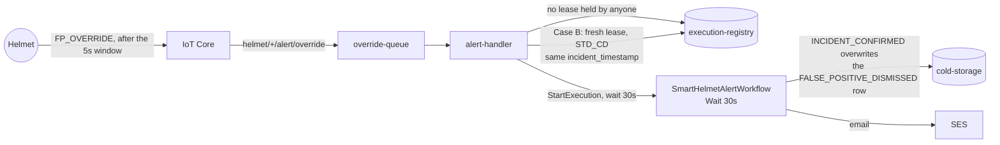
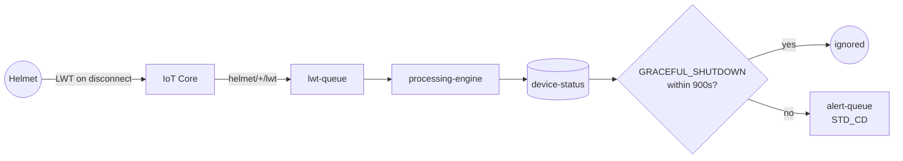

# Scenario matrix

Every incident path the system actually implements, from trigger to storage
outcome. The design intent is in [`Research-phase/Alert_Infra_design.md`](../Research-phase/Alert_Infra_design.md)
(scenarios 1A/1B/2A/2B); **this document describes the code**, and where the
implementation diverges from that design the difference is called out rather
than smoothed over.

Line references are to `main.py` in each service and to
`infra/shared-data/step_functions.tf`.

---

## 1. The path an incident takes

```
helmet/<id>/telemetry ──IoT rule──▶ telemetry-queue
                                        │
                                  telemetry-processor          hot-storage (TTL 24h)
                                        │ crash_flag = true
                                        ▼
                                   crash-queue
                                        │
                                  processing-engine ── reads hot-storage over [t-15s, t]
                                        │              max speed > 10 → STD_CD
                                        │              max speed ≤ 10 → FP_CD
                                        │              no rows       → retrospective
                                        ▼
                                   alert-queue
                                        │
                                   alert-handler ── takes a lease, starts the workflow
                                        ▼
                            SmartHelmetAlertWorkflow (Wait → lease check → outcome)

helmet/<id>/alert/override ──rule──▶ override-queue ──▶ alert-handler
helmet/<id>/lwt            ──rule──▶ lwt-queue      ──▶ processing-engine ──▶ alert-queue
helmet/<id>/control        ──rule──▶ control-queue  ──▶ processing-engine ──▶ device-status
helmet/<id>/alert/status   ◀── alert-handler publishes START_COUNTDOWN / DISMISS
```

Two queues feed each service, and the services are pull-based: there is no
direct call from one service to another. The only synchronous hops are the
Step Function task integrations to DynamoDB and SES.

---

## 2. Vocabulary

**Execution registry** (`helmetId` as the only key) — one row per helmet, i.e.
the *active lease*. At most one incident can own a helmet at a time.

| `status` | Meaning |
|---|---|
| `INITIALIZING` | Lease written, workflow not yet started |
| `STD_CD` | Standard countdown running (30 s) |
| `FP_CD` | False-positive countdown running (5 s) |
| `CANCELLED` | Cancelled inside the window |
| `CONFIRMED` | Window elapsed, rider was notified |
| `FALSE_POSITIVE_DISMISSED` | FP window elapsed, dismissed silently |

**Cold storage** (`helmetId` + `timestamp`) — the durable record, one row per
incident. Note the attribute is `Status` here, not `status`.

| `Status` | Meaning |
|---|---|
| `INCIDENT_CONFIRMED` | Confirmed and escalated |
| `INCIDENT_CANCELLED` | Cancelled inside the window |
| `FALSE_POSITIVE_DISMISSED` | Ruled out as a false positive |
| `RESOLVED_BY_LATE_CANCEL` | Confirmed, then cancelled after the window |

**Countdown windows** come from SSM, not from the code:
standard `30 s`, false positive `5 s`, retrospective `300 s`.

---

## 3. The matrix

| # | Scenario | Trigger | Classification | Alert workflow path | Registry ends | Cold storage | Email | Helmet |
|---|---|---|---|---|---|---|---|---|
| **1A** | Standard, cancelled in time | High-speed crash, rider cancels within 30 s | `STD_CD` | `WaitWindow` → `CheckLease` → `WriteCancelledIncident` | `CANCELLED`, lease deleted | `INCIDENT_CANCELLED` | — | `DISMISS` |
| **1A** | Standard, no cancel | High-speed crash | `STD_CD` | `ConfirmIncident` → `WriteConfirmedIncident` → `SendAdminAlert` | `CONFIRMED`, lease deleted | `INCIDENT_CONFIRMED` | *incident confirmed* | — |
| **1B** | Cancel arrives after the window | Cancel after the 30 s window elapsed | — | Reconciliation: `IsReconciliable` → `MarkResolved` → `SendStandDown` | already deleted | `RESOLVED_BY_LATE_CANCEL` | *incident resolved* | — |
| **2A** | False positive, dismissed | Low-speed crash, no override within 5 s | `FP_CD` | `DismissFalsePositive` → `WriteFalsePositiveDismissal` | `FALSE_POSITIVE_DISMISSED`, lease deleted | `FALSE_POSITIVE_DISMISSED` | — | `START_COUNTDOWN` (5 s) |
| **2A** | False positive, overridden in time | Low-speed crash, `FP_OVERRIDE` within 5 s | `FP_CD` → `STD_CD` | Old workflow exits; **new** 30 s workflow runs | `STD_CD` under a new owner | `INCIDENT_CONFIRMED` after 30 s | *incident confirmed* | `START_COUNTDOWN` (30 s) |
| **2B** | Override arrives after the FP window | `FP_OVERRIDE` after dismissal | `STD_CD` (fresh) | Fresh 30 s countdown, fail-safe | `STD_CD` → `CONFIRMED` | row **reclassified** to `INCIDENT_CONFIRMED` | *incident confirmed* | `START_COUNTDOWN` (30 s) |
| **LWT** | Genuine disconnect | Device drops without graceful shutdown | `STD_CD` | As 1A | as 1A | `INCIDENT_CONFIRMED` | *incident confirmed* | — |
| **LWT** | Graceful disconnect | `GRACEFUL_SHUTDOWN` then LWT within 900 s | — | none — LWT ignored | untouched | none | — | — |
| **Retro** | Crash with no telemetry history | Crash event, but hot-storage has no rows in `[t-15 s, t]` | `retrospective` | 300 s countdown, then as 1A | as 1A | `INCIDENT_CONFIRMED` | *incident confirmed* | `START_COUNTDOWN` (300 s) |
| **Dup** | Duplicate or stale crash | New crash for the same helmet | — | new lease only if its timestamp is **newer** | old workflow exits on ownership mismatch | — | — | — |
| **FP-x** | Override while another incident owns the helmet | `FP_OVERRIDE` for a helmet in a different incident | — | ignored | untouched | — | — | — |

---

## 4. What each scenario looks like in sequence



### 1A — standard, cancelled in time



`telemetry-processor` writes the batch to hot storage and, because
`crash_flag` is true, forwards a crash event. `processing-engine` reads the
15 seconds of telemetry up to impact, sees a peak speed above 10, and emits
`STD_CD` to `alert-queue`.

`alert-handler` takes the lease (`INITIALIZING`), starts
`SmartHelmetAlertWorkflow` with `wait_seconds = 30`, flips the lease to
`STD_CD`, and publishes `START_COUNTDOWN` to the helmet.

If `CANCEL` arrives before `serverDeadline`, the lease is set to `CANCELLED`
and the helmet gets `DISMISS`. When the workflow wakes it re-reads the lease,
sees `CANCELLED` owned by its own incident, writes `INCIDENT_CANCELLED` to cold
storage, deletes the lease, and ends. **No email is sent.**

If nothing arrives, the workflow sets the lease to `CONFIRMED`, writes
`INCIDENT_CONFIRMED`, sends the SES email, and deletes the lease.

### 1B — cancel after the window



By this point `handle_cancel` finds no active lease. It falls back to cold
storage, looks up the row by `(helmetId, incident_timestamp)`, and — if the
`incidentId` matches — starts `SmartHelmetReconciliationWorkflow` with

```python
"is_reconcilable": 0 <= now - float(incident_timestamp) <= 300
```

`MarkResolved` updates the cold-storage row **only** from `INCIDENT_CONFIRMED`
to `RESOLVED_BY_LATE_CANCEL`, then sends a stand-down email. A duplicate or
racing reconciliation loses the conditional write and exits silently — that is
an expected outcome, not a failure.

### 2A / 2B — false positive





A low-speed crash classifies as `FP_CD` with a **5-second** countdown, so the
rider has five seconds to say "I'm fine".

- **No override** → the workflow marks the lease `FALSE_POSITIVE_DISMISSED`,
  writes the same value to cold storage, and exits. Nothing is emailed.
- **Override inside the window** (`FP_OVERRIDE`) → the lease is still owned by
  the same incident, so `alert-handler` upgrades it **in place** to a fresh
  `STD_CD` lease under a new owner id (`uuid5(incident_id + ":FP_OVERRIDE")`)
  and starts a second, 30-second workflow. The first workflow wakes later, sees
  the owner no longer matches, and exits without writing anything.
- **Override after the window** → the lease is already gone. This is the
  fail-safe path: rather than dropping the rider's request, `alert-handler`
  starts a **new** standard countdown. The distinction matters — the design
  says never silently discard an override, and the code preserves that.

> **Note on 2B:** the new incident reuses the override message's
> `incident_timestamp`, which is the same value the FP dismissal wrote. Cold
> storage therefore holds one row per `(helmetId, timestamp)`, so the row is
> **reclassified** from `FALSE_POSITIVE_DISMISSED` to `INCIDENT_CONFIRMED`
> rather than appended. The audit trail keeps the final state, not the history.

### LWT — genuine disconnect vs graceful shutdown



The helmet's last-will message lands in `lwt-queue`. `processing-engine` checks
`device-status`: if the device recorded `GRACEFUL_SHUTDOWN` less than
`lwt_grace_period_seconds` (900 s) ago, the LWT is **ignored** — that is the
normal battery-saver path. Otherwise it is treated as a genuine drop and emits
a `STD_CD` alert, which then flows through exactly the same 30-second
countdown as a crash.

### Retrospective

If the crash arrives but hot storage has no rows in the 15 seconds before
impact — telemetry gaps, expiry, or a device that only sent the crash batch —
the engine cannot compute a peak speed. It still escalates, labelling the
alert `retrospective` and using the 300-second window instead of guessing
`FP_CD`. This is a deliberate "cannot disprove, so escalate" choice.

---

## 5. Guarded transitions

Every state change that could race is conditional. This is what makes the
workflow safe against duplicate alerts, late messages and retries.

| Write | Table | Condition | On failure |
|---|---|---|---|
| `acquire_lease` | registry | `attribute_not_exists` / expected owner + timestamp | Incident does not start |
| `ConfirmIncident` | registry | `ownerIncidentId` matches, `status = STD_CD` | `SilentExit` |
| `DismissFalsePositive` | registry | `ownerIncidentId` matches, `status = FP_CD` | `SilentExit` |
| `DeleteCancelledLease` | registry | owner matches, `status = CANCELLED` | `SilentExit` |
| `DeleteFalsePositiveLease` | registry | owner matches, `status = FALSE_POSITIVE_DISMISSED` | `SilentExit` |
| `DeleteConfirmedLease` | registry | owner matches, `status = CONFIRMED` | `SilentExit` |
| `handle_cancel` | registry | owner matches, status in `{INITIALIZING, STD_CD, FP_CD}`, `serverDeadline >= now` | Falls through to reconciliation |
| `MarkResolved` | cold storage | `incidentId` matches, `Status = INCIDENT_CONFIRMED` | `SilentExit` |

`SilentExit` is a `Pass` state ending the execution successfully. A lost
conditional write means *someone else already handled it*, which is a normal
outcome — failing the execution would alarm on correct behaviour.

---

## 6. Known limitations

These are properties of the current implementation, not bugs discovered by
accident. Anything that is being changed is tracked in the backlog; anything
accepted is recorded with its reason.

1. **The false-positive window is 5 seconds end-to-end.** That budget includes
   device → IoT Core → SQS → `alert-handler` → Step Functions, which is tight
   enough that the FP path may resolve before an `FP_OVERRIDE` is processed —
   pushing real traffic onto the 2B fail-safe instead of the in-place upgrade.
   The fail-safe is correct; the timing is optimistic. This has not been
   measured under load.
2. **`is_reconcilable` uses the device's timestamp**, not server time. Client
   clock skew of more than five minutes silently disables reconciliation.
3. **A late cancel does not notify the helmet.** The reconciliation path sends
   an email but never publishes `DISMISS` to `helmet/<id>/alert/status`, so the
   rider's HUD is not cleared by the cloud in scenario 1B.
4. **Late overrides reclassify rather than append**, as described above — the
   false-positive record is replaced, not retained alongside the confirmation.
5. **Reconciliation only mutates confirmed incidents.** A late cancel for an
   already-cancelled or dismissed incident exits silently, which is correct but
   means the request is invisible outside the ECS log.
6. **Three configuration parameters are declared but never read**:
   `unconfirmed_chunk_ttl_hours`, `mass_alert_threshold`,
   `firmware_anomaly_threshold`. They are provisioned in SSM and imply features
   that do not exist yet.
7. **Malformed telemetry is dropped, not routed.** A payload without
   `helmet_id` is deleted from `telemetry-queue` and logged; it never reaches a
   DLQ. Other processing errors leave the message for retry, so those do reach
   the DLQ.

---

## 7. Where this lives in the code

| Step | Location |
|---|---|
| IoT rules, topics, queue targets | `infra/messaging/iot_core.tf` |
| Batch write + crash forwarding | `services/telemetry-processor/src/main.py:32-164` |
| Crash classification (`max_speed > 10`) | `services/processing-engine/src/main.py:100-112` |
| Graceful-shutdown / device status | `services/processing-engine/src/main.py:139-182` |
| LWT handling and 900 s grace | `services/processing-engine/src/main.py:184-238` |
| Lease acquisition and workflow start | `services/alert-handler/src/main.py:81-213` |
| Cancel, including late reconciliation | `services/alert-handler/src/main.py:229-294` |
| False-positive override, both cases | `services/alert-handler/src/main.py:297-348` |
| Alert workflow definition | `infra/shared-data/step_functions.tf:50-275` |
| Reconciliation workflow definition | `infra/shared-data/step_functions.tf:277-339` |

---

## 8. Reproducing a scenario

`simulator/helmet_sim.py` drives every path interactively:

| Menu | Emits | Exercises |
|---|---|---|
| `1` | 10 datapoints, 45 mph, no crash | Normal path |
| `2` | 5 datapoints, 65.5 mph, `crash_flag` | 1A, 1B |
| `3` | 5 datapoints, 5 mph, `crash_flag` | 2A |
| `4` | Cancel button | 1A cancel, 1B late cancel |
| `5` | False-positive override button | 2A upgrade, 2B fail-safe |
| `6` | `GRACEFUL_SHUTDOWN` control message | LWT grace period |

1B is produced by running `2`, letting the 30-second window expire, then
pressing `4`. 2B is produced by running `3`, waiting past 5 seconds, then
pressing `5`.
