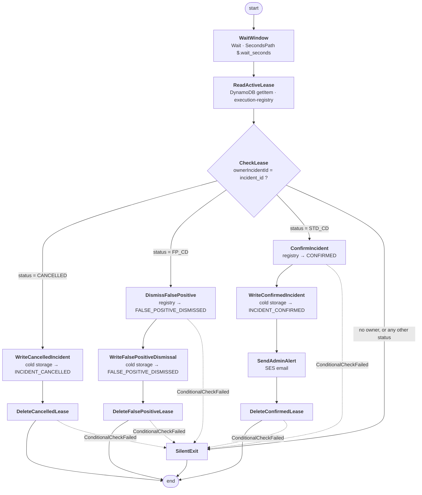
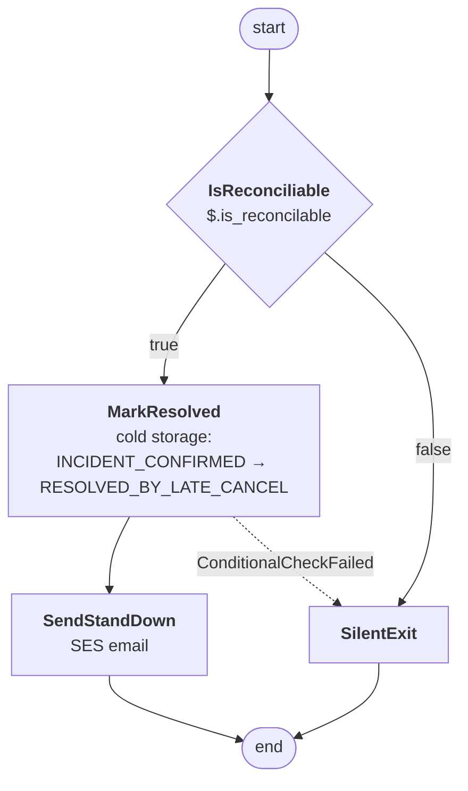

# Step Functions workflows

Two state machines, both defined in
[`infra/shared-data/step_functions.tf`](../infra/shared-data/step_functions.tf):

| | `SmartHelmetAlertWorkflow` | `SmartHelmetReconciliationWorkflow` |
|---|---|---|
| Started by | `alert-handler` | `alert-handler`, on a late cancel |
| Purpose | Hold one incident open for a countdown, then resolve it | Reopen an already-confirmed incident |
| Input | `helmet_id`, `incident_id`, `incident_timestamp`, `wait_seconds` | `helmet_id`, `incident_id`, `incident_timestamp`, `is_reconcilable` |
| Duration | 5 s, 30 s or 300 s | milliseconds |

Both are **Standard** workflows (the default), which matters: standard
executions are limited to one execution with a given name per state machine
for 90 days. The service uses that as an idempotency guard rather than
reimplementing one.

---

## 1. Why two machines and not three

The original design (`Research-phase/Alert_Infra_design.md`) specified a
separate countdown workflow for standard alerts and for false positives. The
implementation collapsed them into **one** workflow, because the two countdowns
are structurally identical — the only difference is which outcome gets written
at the end of the wait.

Instead of two near-duplicate definitions, the workflow reads the lease and
branches on `status`. The countdown length is not baked into the state machine
at all; it arrives as `wait_seconds`:

| `alert_type` | `wait_seconds` | Registry status written | Outcome |
|---|---|---|---|
| `STD_CD` | 30 | `STD_CD` | Confirm and email |
| `FP_CD` | 5 | `FP_CD` | Dismiss silently |
| `retrospective` | 300 | `STD_CD` | Confirm and email |

`retrospective` deliberately maps to the `STD_CD` **status** while using the
300-second window: it is still a standard escalation, just a slower one.

Reconciliation stayed a separate machine because it acts on a different table
(cold storage, not the registry) and on a different triggering event (a message
arriving after the fact, not a timer elapsing).

---

## 2. Alert workflow



Every dotted edge is a `Catch` on `DynamoDB.ConditionalCheckFailedException`
that routes to `SilentExit`. Losing a conditional write means another actor
already resolved this incident — a normal outcome, not a failure. The one
transition that cannot lose is `WriteConfirmedIncident`, which is an
unconditional `putItem` reached only after `ConfirmIncident` won its
conditional write.

### What `CheckLease` actually verifies

All three branches require **both**:

1. `ownerIncidentId` is present, and
2. it equals the workflow's own `incident_id`.

That second condition is the whole safety story. A lease row is a single item
per helmet, so when a new incident takes the helmet the row is overwritten. The
older workflow still wakes up on schedule, reads the row, finds someone else's
`incident_id`, and exits without touching anything. Nothing has to be cancelled.

---

## 3. Reconciliation workflow



`is_reconcilable` is decided in `alert-handler`, not in the workflow:

```python
"is_reconcilable": 0 <= now - float(incident_timestamp) <= 300
```

Two consequences worth knowing:

- The lower bound of zero rejects an incident timestamped in the future, which
  is what a device with a badly skewed clock produces.
- The 300-second window is measured against the **device's** timestamp, so
  clock skew of more than five minutes disables reconciliation entirely.

> **Naming trap in the source:** the *state* is named `IsReconciliable`,
> but the *input field* is `is_reconcilable`. They differ by one letter and
> both spellings appear in the code — a rename of either alone silently
> breaks the Choice.

`MarkResolved` only fires when the cold-storage row is still
`INCIDENT_CONFIRMED`. If the incident was cancelled or dismissed, the
conditional write fails and the execution exits quietly — the request is
recorded in the ECS log but nothing changes.

---

## 4. The lease

The execution registry holds exactly one row per helmet, which is what makes
"one active alert per helmet" enforceable without a lock service.

```json
{
  "helmetId":        "HELMET-001",
  "ownerIncidentId": "uuid of the incident that owns the helmet",
  "status":          "STD_CD",
  "countdownStatus": "STD_CD",
  "alertType":       "STD_CD",
  "incidentTimestamp": 1699999999,
  "serverDeadline":  1700000029,
  "executionArn":    "arn:aws:states:...",
  "TimeToExist":     1700086429
}
```

`serverDeadline` is server time (`now + wait_seconds`) and is what
`handle_cancel` compares against — never the device timestamp. `TimeToExist` is
a DynamoDB TTL, so a crashed workflow cannot leave a helmet permanently leased.

Who acts on which status:

| `status` | Written by | Consumed by |
|---|---|---|
| `INITIALIZING` | `alert-handler` (lease acquisition) | `alert-handler` (cancel window) |
| `STD_CD` / `FP_CD` | `alert-handler` (after the workflow starts) | the workflow, at the end of its wait |
| `CANCELLED` | `alert-handler` (in-window cancel) | the workflow → `WriteCancelledIncident` |
| `CONFIRMED` | the workflow | the workflow → email, then delete |
| `FALSE_POSITIVE_DISMISSED` | the workflow | the workflow → delete |

---

## 5. Emails

Both machines send SES email to the address in `sns-email-address`, used as
both sender and recipient. That identity must be **verified in SES** or
`SendEmail` fails and the execution fails with it — there is no fallback
channel. For a sandbox SES account the recipient must also be verified.

| Workflow | Subject | Trigger |
|---|---|---|
| Alert | `Smart Helmet incident <id> confirmed` | countdown elapsed |
| Reconciliation | `Smart Helmet incident <id> resolved` | accepted late cancel |

---

## 6. Reading and changing this

- The **outcome vocabulary** lives in the state machine's `Parameters` blocks,
  not in the services. Adding a new cold-storage status means editing
  `WriteConfirmedIncident` and its siblings.
- The **decision logic** lives in the services: classification in
  `processing-engine`, leasing and override handling in `alert-handler`. The
  workflows only enforce it.
- The **windows** live in SSM (`/smart-helmet/config/*_window_seconds`), so
  changing a countdown does not require a deploy.

For the end-to-end behaviour of each path, including the cases that never reach
a state machine, see [SCENARIO-MATRIX.md](SCENARIO-MATRIX.md).
